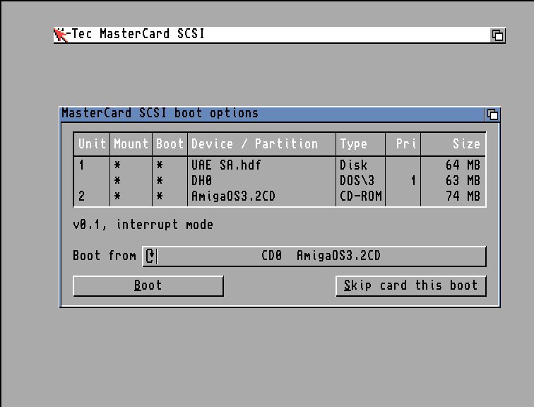

# mtec-mastercard

A new SCSI driver and boot ROM for the MasterCard SCSI option of the M-Tec
T1230 (Viper) Amiga 1200 accelerator, which has an NCR 53CF94 chip.
`mastercard.device` replaces M-Tec's `mtecscsi.device` 2.3. It is written from
scratch in C, and the boot ROM contains no M-Tec code, so both can be shared.

The repo also has `MTecPatch`, a patch for M-Tec's own driver, and the tools
used to analyse the card. Everything else, including the hardware findings,
test history and the patched M-Tec ROM, is in [DETAILS.md](DETAILS.md).

## Added features

**The driver, `mastercard.device`:**
- **Large disks:** reads and writes up to 2 TB, with the TD64, NSD and ETD
  64-bit commands. The ETD ones check the medium change count.
- **SCSI commands:** `HD_SCSICMD` with automatic sense data, including 16-byte
  commands.
- **More device commands:** `TD_GETGEOMETRY`, `TD_GETNUMTRACKS`,
  `TD_EJECT`, `TD_CHANGESTATE`, write protection in `TD_PROTSTATUS` (CD-ROM, WORM
  and write-protected disks), and an NSD device query.
- **Interrupt-driven transfers:** the data moves in the card's interrupt
  server, so audio, the display and serial keep running during transfers. A
  polled variant, slightly faster but with interrupts off during each chunk,
  is also built.
- **Large reads in one go:** reads of 512 KB and more use the chip's 24-bit
  transfer counter instead of restarting every 64 KB.
- **Errors are caught:** parity and illegal-operation errors from the chip end
  the command with an error and reset the bus, instead of passing unnoticed.

**The boot ROM**, for a 27C512 EPROM in the card's socket:
- **Mounting:** reads each disk's RDB, loads the file systems stored in it
  (FFS, PFS3 and so on) with its own loader before DOS starts, and mounts the
  partitions.
- **Booting:** from a partition anywhere on the disk, not only below 2 GB.
  Tested in Amiberry with the boot partition at 2.5-3.5 GB.
- **Start-up:** waits up to 10 s for a drive that is still spinning up, and
  skips empty SCSI IDs after a disk whose RDB has "last disk" set.
- **CD boot:** [installs AmigaOS 3.2 without floppies](images/cdboot.png). A bootable CD (the
  AmigaOS 3.2, CDTV and CD32 kind) in a SCSI CD-ROM drive boots, with a small
  read-only ISO 9660 file system built into the ROM. It handles disc changes,
  so the boot CD can be taken out and put back. A CD file system in a disk's
  RDB or in Kickstart is used instead when there is one. The ROM's contents
  are compressed to make room. The 3.2 CD boots on the real card from a
  BlueSCSI's CD image; see [DETAILS.md](DETAILS.md#cd-boot).
  The CD boot is based on the
  [A4091 software](https://github.com/A4091/a4091-software), and the small ISO
  9660 file system on [ODFileSystem](https://github.com/reinauer/ODFileSystem/).

**The boot menu:** hold the right mouse button at power-on. It lists the
devices with their partitions, and a CD drive with the disc's name. "Boot
from" chooses which partition or CD boots, and "Skip card this boot" leaves
the card's partitions out for one boot. Both buttons together still open
Kickstart's own Early Startup menu.



## Fixed bugs

- Reads and writes past 2 GB work: the byte offset is handled as unsigned.
- The whole disk is reachable through normal I/O, also beyond 4 GB.
- `TD_REMOVE` with NULL removes the change handler instead of calling it later.
- `HD_SCSICMD` without autosense reports a bad status as `HFERR_BadStatus` (45).
- After a selection timeout, `scsi_Status` is 0.
- Errors reported by the SCSI chip end the command and reset the bus, instead
  of going unnoticed.

`MTecPatch` brings the same command fixes to the original `mtecscsi.device`,
from RAM or built into its ROM; see [DETAILS.md](DETAILS.md).

## Performance

Amiga 1200, T1230 at 42 MHz, Kickstart 3.0, BlueSCSI Pico with TurboMax.
devtest's read speeds, in KB/s:

| Read size | M-Tec 2.3 | `mastercard.device` from the ROM |
|---|---:|---:|
| 512 KB | 6789 | **7018** |
| 128 KB | **6504** | 6412 |
| 32 KB | **5350** | 5227 |

The board has no real DMA: the CPU moves every byte through its data port, so
transfers take nearly all of the CPU. How much CPU time is left for programs
during continuous 512 KB reads, measured by `MCCpuBench`:

| Driver | Read speed | CPU left for programs |
|---|---:|---:|
| M-Tec 2.3 | 6127 KB/s | 8.0% |
| `mastercard.device`, full speed (default) | 6538 KB/s | 0.0% |
| `mastercard.device`, cooperative (`MC_COOP_US_PER_64K=500`) | 6209 KB/s | 4.6% |

During transfers the vertical blank interrupt keeps its normal 20.0 ms rhythm
with the interrupt-driven driver; the polled variant delays it to 22-34 ms.
The measurements and the tuning behind them are in
[`MCDevice/performance.md`](MCDevice/performance.md).

## Building and using

You need the Bebbo `m68k-amigaos-gcc` in `/opt/amiga/bin`, the Amiga NDK 3.2,
Python 3, a host C compiler, and Docker for the ROM, which is built with GCC
16.2 from the `stefanreinauer/amiga-gcc:gcc-v16.2` image. The ROM is compressed
with salvador (ZX0, by Emmanuel Marty; [reinauer/salvador](https://github.com/reinauer/salvador)), a submodule
that `build.sh` builds.

```sh
git submodule update --init
cd MCDevice && ./build.sh
```

- **EPROM:** program `MCDevice/rom/MCROM-irq-27C512.bin` into a 27C512 for
  the card's socket. Keep the original EPROM.
- **Without an EPROM:** `mastercard-prod-irq.device` can be loaded from
  `DEVS:` as `mastercard.device`, on a card whose ROM driver isn't running.
- **Test disks:** `mkadf.sh` builds them; see [DETAILS.md](DETAILS.md).

Copyrighted files are not in the repo and must not be added: M-Tec's disks and
ROM, FFS, MUI, OS libraries, reference manuals and every `.adf`. See
`.gitignore`.

## Credits

- **CD boot:** based on the [A4091 software](https://github.com/A4091/a4091-software):
  which CDs boot (a `CDTV` or `AMIGA BOOT` System ID), and taking the CD file
  system from Kickstart or a disk's RDB.
- **The built-in ISO 9660 file system** (`MCDevice/cdfs.c`): based on
  [ODFileSystem](https://github.com/reinauer/ODFileSystem/) by Stefan Reinauer
  (BSD-2-Clause), cut down to plain ISO 9660 for booting.
- **ROM compression:** ZX0 by Einar Saukas, compressed with salvador by Emmanuel
  Marty, and decoded with salvador's 68000 decoder (zlib licence), in
  `external/salvador`.
